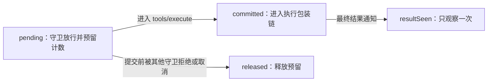

**第 2 天第一小节：正式接收工具结果，并把结果记到正确的调用**

工程记录：2026-11-01。本文对应本地分支 `fix/native-tool-results`；工程完成与个人学习验收分别记录。

2026-11-03 更新：本文保留接入阶段的历史记录，最新三项有限语义机制与结果见 [面试速读](面试速读.md)。读改再读共三次调用、两次读取，历史“第三次读取”应准确称为“第三次调用中的第二次读取”。

**先看本轮完成的变化**

| 对照 | 运行方式 | 第三次调用（第二次读取） |
|---|---|---|
| A：固定原版 | `npm.cmd run day1` | 工具函数执行前被拒绝 |
| B：原版加诊断桥接 | `npm.cmd run day1 -- --bridge` | 进入工具函数，得到 `after` |
| 当前工作副本：接入修复及生命周期补丁 | `npm.cmd run day1 -- --working` | 无需桥接，进入工具函数，得到 `after` |

三组都使用真实 Cordis、真实 DSH ToolRuntime 和真实文件读写；工具动作、Agent handle 与外围服务是受控夹具，没有模型自主决策。工作副本额外修复了调用生命周期边界，因此不能在所有实验中直接把它与“仅修接入”的 B 组混为一组。

**第一处代码：两个参数，分别负责身份和结果**

宿主实际通知的是 `tools/result(exec, result)`：`exec` 保存工具名、参数、callId、Agent、signal 等身份信息；`result` 保存最终执行结果，包括 `isError`、`value`、`content`。

正式监听器位于 `packages/loopguard/lib/index.js`：

```javascript
ctx.on('tools/result', (execution, result) => {
  // Native events keep the frozen call identity and final result separate.
  state.recordResult(execution.agent, { ...execution, result });
});
```

`{ ...execution, result }` 创建一个新对象。把 execution 视作字典时，其浅复制作用类似 Python 的 `{**execution, 'result': result}`：保留原来的调用身份，再添加结果字段，供已有状态机读取。

这个选择让修改保持集中：既不改宿主事件格式，也不用重写上游结果指纹与进展规则。浅复制保留 Agent 等对象引用；原生 exec 不变，所以日志中的 `exec has result field = false` 仍然正常。回归还确认原生 exec 和最终结果都是冻结对象。

**第二处代码：为什么结果接入之外，还要检查调用关联**

同一个运行时可以同时有多次调用，结果不一定按发起顺序返回。还有些请求会在进入本插件守卫前，就被其他策略拒绝或取消；它们仍会产生结果通知，却没有本插件的预留记录。

原来的 `findCall` 在找不到明确 callId 时，会回退到最后一条未完成调用。这样，一个不属于该记录的结果就可能释放或更新它。

现在，有明确 callId 就只查这一条；找不到就忽略该结果。保留无编号旧调用的兼容回退，但原生集成回归都使用明确编号，并假定每次调用有独立编号。本轮未新增宿主 token 关联机制。

新增的一条真实调度回归复现了这个边界：先预留调用 A，再让调用 B 被执行前策略拒绝；B 的结果必须保留 A 的预算占用。修复前预算被错误返还，修复后正确保持限制。

**调用的三个关键阶段**



提交表示进入执行包装链，并不证明工具函数一定已开始。包装链也可能有副作用，因此本轮只返还尚未提交的预留；已经进入执行通路的取消不会被一概当作“没有执行”。

释放还要区分进展阶段：上游观察到进展时会推进 progress epoch，并清空旧阶段的无进展计数与重复组。如果旧阶段的预留此后才取消，再扣减当前计数就会少算新调用。

因此调用记录新增预留时的 `progressEpoch`；释放只回滚同一 epoch 的计数，并将预留标为已释放。重复结果不会再次推进进展，已清理会话也不会因迟到结果被重新创建。

**验证记录与范围**

- 最初 17 条回归在原实现上为 7 通过、10 失败；单独修正事件接入后为 11 通过、6 失败。
- 随后增加 1 条真实调度的未匹配 callId 用例，先看到失败，再修正关联逻辑。
- 最终 `npm.cmd test`：18/18 通过。其中 12 条原生组件集成用例，6 条直接使用真实状态机的边界用例。
- 原生集成覆盖真实读改再读、固定成功输出与工具异常、其他守卫拒绝、执行前/提交前取消、已启动调用取消、结果乱序、同一 turn 多 step、新 turn、同一运行时的会话隔离与清理。
- `npm.cmd run probe`：原版及诊断桥接的既有 19 条组件回放重新执行，断言全部通过，保留原有缺陷和控制轨迹。
- `npm.cmd run verify:vendor`：12 个固定上游文件哈希全部通过。
- `npm.cmd run day1 -- polling --working`：真实后台进程仍运行时，第三次查询仍被拒绝，进程随后正常完成。这是保留的策略缺口；修复结果接入未解决合法等待。
- `npm.cmd run report`：Python 成功读取本次重新生成的 19 条原版/桥接轨迹。

日志位于 `results/day2/`，工作副本的教学轨迹位于 `results/day1/read-edit-read-working-stock.json`。这些结果在本地生成，按现有 Git 规则忽略。

18 条回归与原来的 19 条轨迹验证不同范围，不合并计算准确率。工具异常没有算成成功进展，但“工具成功返回、程序退出失败”的 shell 结果语义仍待后续适配。时间戳噪声、描述字段绕过和有限后台等待也仍待处理。

**本轮里程碑事实摘要，供带回简历对话**

- 完成模块：原生工具结果事件接入、callId 严格匹配、预留/提交/释放与重复结果处理、跨进展阶段回滚和会话清理保护。
- 本人职责记录：确定改进目标与实验范围，参与项目作用、结构和复现方法的讨论；本轮代码实现与自动验证由助手执行，独立操作、代码理解和实际学习用时仍待本人验收。
- 实验口径：真实宿主组件配合受控动作与工具夹具；本轮结果属于兼容性与生命周期修复，尚无完整模型 Agent 任务收益数据。
- 实测结果：新增 18 条回归通过；既有 19 条原版/桥接轨迹重新运行通过；工作副本无需桥接即可完成读改再读；上游 12 文件哈希不变。
- 公开产物：已有公开仓库 <https://github.com/anuidy/agent-loopguard>；本轮补丁、测试和本文目前位于本地开发分支，尚未推送。

**接下来只推进一小步**

先结合监听器和状态图确认结果如何影响下一次工具检查，再设计 shell actionKey 的字段：哪些参数改变真实操作，哪些只是展示信息。个人操作与理解验收继续独立记录，不以自动测试通过替代。
