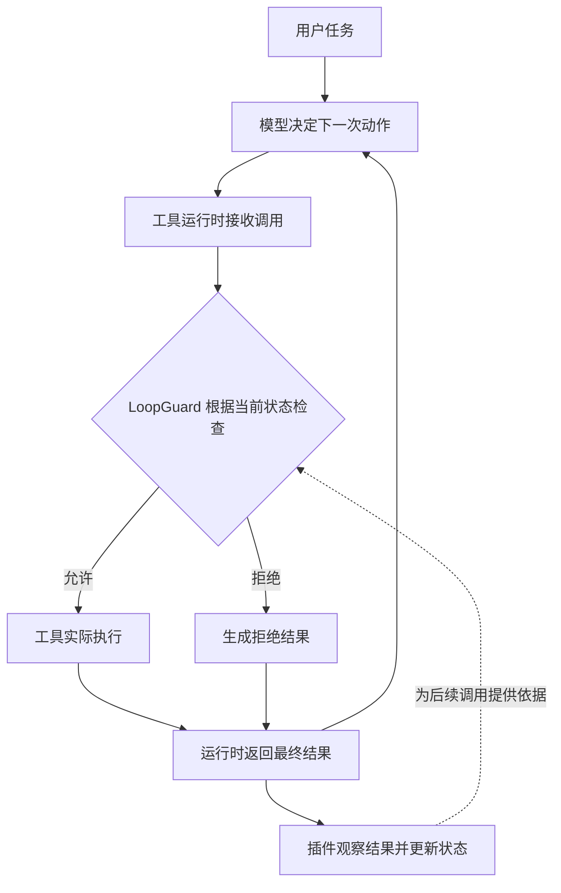

**DeepSeek Harness 工具语义感知循环控制：作用、结构与运行机制**

依据本地代码及进度记录核对：2026-10-24。

**一、它的作用是什么**

Agent 做任务时，通常反复经历“模型决定下一步 → 调用工具 → 观察结果 → 再决定下一步”。工具可以是读取文件、修改代码、运行测试、查询后台作业等。

本项目改进这个循环中的工具执行控制：结合实际操作、结果证据和任务状态，判断一次调用是否值得继续执行，以及后台任务是否值得继续等待。目标是减少无效重复，同时减少对正常工作的误拦。

| 场景 | 期望行为 | 判断依据 |
|---|---|---|
| 读文件，修改后再读 | 允许重新检查 | 中间已有操作和结果变化 |
| 相同测试反复失败，只变了时间戳 | 在预算内识别并限制无效重复 | 实际操作相同，失败证据没有实质变化 |
| 后台测试仍在运行 | 在等待预算内允许继续等待 | 作业仍未结束，并符合等待频率、次数和时长限制 |
| 命令不变，只换一句工具描述 | 仍归入同一实际操作 | 展示字段没有改变执行含义 |
| 重试发现了新的错误 | 根据新证据更新判断 | 失败也可能提供有价值的信息 |

这些是目标行为，完整语义策略尚未实现。最终是否降低误拦、节省调用或改善任务完成，需要实验验证。

**二、总体结构是什么**

系统主体使用已有 DSH 运行时和插件机制，在工具执行管线中接入守卫。以下图示标明目标位置；当前教学实验用固定脚本代替模型决定工具动作。

| 部分 | 职责 | 本项目中的位置与状态 |
|---|---|---|
| 模型与 Agent loop | 决定做什么，并结合结果决定下一步 | 完整模型任务尚未验证；教学入口使用固定动作 |
| Cordis Context | 连接服务、事件和插件 | 装配在 lab/native-harness.mjs，使用真实组件 |
| DSH ToolRuntime | 注册工具，执行策略检查、工具函数和结果通知 | 使用真实宿主组件 |
| LoopGuard 插件接入层 | 将运行时事件连接到守卫状态 | packages/loopguard/lib/index.js，当前仍为上游实现 |
| LoopGuardState | 记录调用、重复组、进展阶段和预算，生成拒绝理由 | packages/loopguard/lib/guard-state.js，当前仍为上游实现 |
| 工具语义适配 | 提取实际操作身份、有效结果证据、后台作业状态 | 待逐步实现，具体文件组织尚未确定 |
| 回放与评测 | 验证具体行为，比较不同策略 | Node.js 负责原生组件回放；Python 负责夹具、验收与统计 |

Python 不参与当前工具调用前的在线守卫判断。插件运行在 Node.js 侧，才能直接接入宿主的工具生命周期；Python 用于构造和评估实验。

**三、这个结构怎样实现作用**

关键是形成闭环：**执行前根据已有证据检查；执行后记录新证据；下一次检查使用更新后的状态。**

1. 接收调用。运行时拿到工具名、参数、Agent、取消信号以及本次调用的 callId。callId 用来关联一次调用的检查、执行和结果。
2. 执行前检查。现有插件通过 tools.guard 检查重复组、预算和停止状态。放行时预留调用记录；拒绝时返回理由，工具函数不执行。
3. 确认进入执行。到达 tools/execute 包装链时，现有插件将调用标记为已提交。这样可以区分预留调用与已经进入执行通路的调用；取消和释放仍需后续集成验证。
4. 工具执行并返回。工具函数实际读写文件或运行程序。运行时最终发出 tools/result(exec, result)，拒绝调用也有结果通知。
5. 关联并更新。插件应通过 callId 找到对应记录，解析结果，再更新已有的进展阶段、重复组和预算。
6. 影响下一次调用。出现有效新证据时允许后续合理操作；缺乏新证据时累计重复或等待消耗；达到限制时拒绝后续工具调用并返回原因。

拒绝工具调用会影响 Agent loop 后续可执行的动作。原插件还会将本轮设为仅允许文本答复；模型是否最终正确总结卡点，仍需完整任务验证。

**语义改进分别作用在哪一步**

| 改进 | 输入 | 计划输出及用途 |
|---|---|---|
| 操作身份 actionKey | 工具名与参数 | 判断是否同一实际操作；对 shell 保留命令、工作目录与执行控制参数，仅忽略已确认无执行含义的展示字段 |
| 结果证据 evidenceKey | 退出状态、错误和工具输出 | 判断是否出现新证据；有限消除时间戳等噪声，并保留原始日志供核对 |
| 作业生命周期 | job_id、running/completed/failed 等状态 | 区分合理等待与重复查询；使用独立等待预算，结合宿主等待和完成通知机制 |

这里的“语义”首先是按工具结构化定义和结果字段解释含义，不要求每次额外调用模型来评分。它也不等于可靠判断整个任务是否已经完成；任务完成需要独立验收。

**四、用当前的读→改→再读说明闭环为何重要**

教学脚本按顺序发出三次调用：第一次读到 before，第二次写入 after，第三次请求重新读取同一文件。

原版接口问题发生在结果返回处：宿主把调用身份和执行结果作为两个参数传出，而插件只接收第一个参数。状态机随后尝试从调用身份内部找结果，得到“结果未知”。

因此文件虽然已经修改，守卫却没有通过这条结果通路观察到进展；第三次同参数读取被重复规则拦截，未进入工具函数。

已有 --bridge 诊断对照把第二参数装入一个新对象，只交给原插件监听器。原状态机收到结果后，第三次读取可以执行并读到 after。这说明结果接入是必要基础；它尚未解决等待预算和失败日志噪声等语义问题。

这个对照使用真实运行时和真实文件读写，但动作由脚本固定，不包含模型自主决定动作。

**五、当前做到哪里，接下来做什么**

- 工程准备完成；依赖与原版来源已固定，5 个插件实现文件仍与上游逐字节一致。
- 历史 19 条缺陷与控制组件回放已通过。它们用于验证具体因果，不能当作普遍准确率样本。
- 默认教学示例已由助手运行并复现误拦；个人操作与理解验收仍待确认。
- 正式接口修复、语义策略和完整模型任务评测尚未完成。完整 DSH 启动仍有环境项待核实。
- 下一步先看懂调用链与桥接对照，再正式修复接口，随后逐步增加语义策略。每日基础 3 小时，最多 4 小时，按实际阶段推进。

最终验证至少保留四组：A 原版；B 仅修结果接入；C 修接入并调宽阈值；D 修接入并加入语义策略。固定模型、提示、任务、工具与预算，分别核算接口修复和语义策略的收益。

计划产物是可审阅的插件改动、可复放轨迹、可自动验收的小任务，以及含逐任务结果和失败分析的对照报告；实测前不预设收益。
