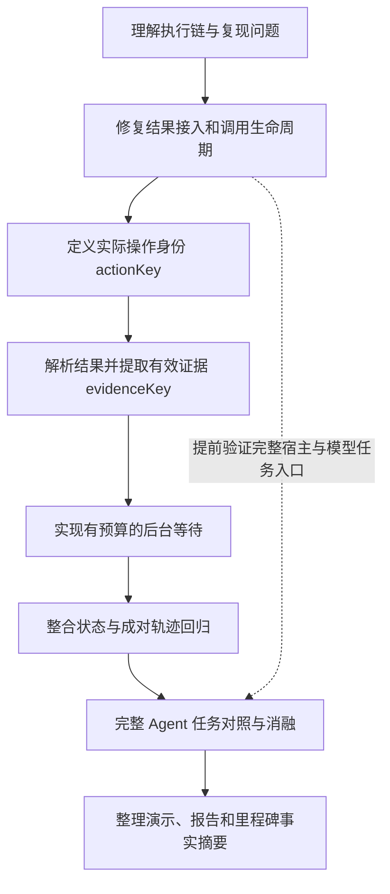

**DeepSeek Harness 工具语义感知循环控制：项目流程与执行计划**

更新日期：2026-11-01。依据实际代码、进度记录和原 14 天方案整理。

2026-11-03 增补：为近期面试先交付三项规则的有限组件版本，38 条回归及 33 条组件对照已通过。对应下表 Day 3—6 的部分工程子项，不代表完整任务评测和个人学习阶段全部完成。当前机制与限制见 [面试速读](面试速读.md)。

**目标与交付**

在已有 DSH 循环守卫上，结合实际操作、结果证据和后台作业状态，改进工具调用的继续、等待和停止判断。复用上游已有的进展阶段、重复组、调用预算和拒绝通路。

第一版交付：可审阅的插件补丁；20—30 条成对组件轨迹；6—10 个可自动验收的完整 Agent 小任务；逐任务对照与失败分析；可复现的演示和项目说明。实际收益由实验决定。

Node.js / JavaScript 负责原生插件、工具生命周期和在线控制；Python 负责测试夹具、任务验收、评测运行与统计。

**从当前进度继续**

| 状态 | 已有事实 | 后续处理 |
|---|---|---|
| 工程准备完成 | 固定依赖、原版包、许可证、回放入口和公开仓库 | 复用现有工程，上游 vendor 保持不变 |
| 接入模块已实现 | 工作副本正确接收结果，补齐调用关联与释放边界 | 讲解、个人验收和版本整理 |
| 验证已执行 | 新增 18 条回归通过；既有 19 条原版/桥接回放重新运行通过；12 个上游文件哈希通过 | 不合并计算准确率，不代替完整任务评测 |
| 个人验收待确认 | 已讨论作用、结构和诊断方法 | 补齐独立操作、机制复述与真实用时记录 |
| 有限语义机制已实现 | shell 身份、已知 unittest 证据与作业等待预算 | 后续补齐泛化边界与完整任务评测 |
| 完整 Agent 待验证 | 历史模型列表检查成功，完整宿主启动仍有环境项 | 提前验证宿主、实际 profile 和最小模型任务 |

版本托管状态以 Git 历史与最新 docs/progress.txt 为准，原阶段记录不替代当前状态。

**总体流程**



每个模块都按“解释机制 → 跑一个可观察例子 → 定义预期行为 → 小步修改 → 验证 → 记录”推进。一轮只处理一个清楚的小目标。

**时间安排**

Day 表示开发阶段，不绑定旧日历日期。原计划的日期已经过期，阶段仍按实际完成情况推进。

每天基础 180 分钟，包含学习、编码、验证和记录。仅 Day 3、5、6、8、10、12 各预留最多 60 分钟机动；单天绝不超过 4 小时。整体基础 42 小时，全部机动用完最多 48 小时。机动用于排障和关键回归，不预先增加功能。

这是整个项目的预算，已完成内容直接复用，不重新分配一套 42 小时。历史个人投入待本人补录，暂不按助手自动执行时长估算剩余个人工时。

| 阶段 | 本阶段重点 | 交付与验收 | 当前状态 |
|---|---|---|---|
| Day 1 | 看懂模型动作、工具运行时和守卫的位置，追踪读改再读 | 能说明工具函数是否执行，以及身份与结果为何分开传递 | 工程完成，个人验收待确认 |
| Day 2 | 正式接入结果，验证调用关联、提交、取消和释放；提前检查完整宿主入口 | 工作副本无需桥接完成读改再读；无进展调用仍受限；生命周期回归通过 | 首个工程子模块已完成，其余待推进 |
| Day 3 | 为 bash/pwsh 定义 actionKey | 改描述仍算同一操作；改命令、工作目录或实际执行控制参数保持区分 | 有限规则已实现，个人验收待确认，可机动 1 小时 |
| Day 4 | 解析 shell 结果，区分工具异常、程序退出与任务状态 | 工具成功返回但程序失败时，不直接视为任务成功；保留新错误证据 | foreground 适配已实现，泛化待验证 |
| Day 5 | 提取 evidenceKey，有限消除已知日志噪声 | 同一失败仅时间戳变化不会持续刷新进展；新错误、失败集合变化保持可见 | 已知 unittest 格式已实现，更多格式待扩展，可机动 1 小时 |
| Day 6 | 按作业身份与生命周期实现有限等待 | 合理等待能取得最终结果；持续运行超过时长、次数或频率限制后有明确反馈 | 有限等待组件已实现，完整通知链待验证，可机动 1 小时 |
| Day 7 | 把语义策略与已有 epoch、重复组和预算整合 | 新机制加入后，取消、计数回滚、会话隔离和清理仍一致 | 待开始 |
| Day 8 | 补齐 20—30 条成对轨迹，完成组件对照并冻结核心范围 | 每条有预期标签；能区分接口、生命周期、阈值和语义策略的影响 | 待开始，可机动 1 小时 |
| Day 9 | 建立 6—10 个完整 Agent 小任务及 Python 验收 | 模型自主决定动作；测试或产物决定成功，日志可追溯 | 待开始 |
| Day 10 | 固定条件运行完整任务对照 | 记录各组任务完成、正确停止、误拦、额外调用、Token 与耗时 | 待开始，可机动 1 小时 |
| Day 11 | 对操作身份、证据和等待机制做消融 | 能说明哪部分带来差异；关键现象有重复验证和失败分析 | 待开始 |
| Day 12 | 修复影响验收的回归，用 Python 汇总并冻结结果 | 每个数字可追溯到配置、任务和日志；报告分母与未完成项清楚 | 待开始，可机动 1 小时 |
| Day 13 | 完善运行说明、状态图、取舍和短演示 | 他人能复现主要案例；准备简短与详细两版讲解 | 待开始 |
| Day 14 | 从干净副本验收第一版，整理版本和事实摘要 | 安装、回放和代表任务可运行；结论与实现一致；摘要交回简历对话 | 待开始 |

**三个核心模块怎样开发**

| 模块 | 先定义什么 | 必须同时验证的正反例 |
|---|---|---|
| 操作身份 | 先核对真实工具参数。保留命令、工作目录、权限及执行控制参数，仅忽略确认无执行含义的展示字段 | 同操作换描述 / 不同目录或命令；不全局删除变化字段，不随意压缩命令中的空白 |
| 结果证据 | 优先结构化状态、退出码和测试证据；只处理明确的噪声模式，保留原始日志 | 同一失败加时间噪声 / 新错误或失败集合变化；失败并不一律没有价值 |
| 有限等待 | 按 job_id 识别 running、completed、failed，结合宿主 wait 和完成通知，设置独立等待预算 | 正常等待后完成 / 持续运行超预算；每次 running 不算新进展 |

**完整环境提前验证**

在 Day 2—3 内优先验证现有 CLI、实际 profile 与最小模型任务，不把环境问题留到评测当天。重核当前模型可用性，模型列表可读与生成可用分别记录。

如果受限环境仍阻止完整宿主启动，使用本机终端核实；当日排障达到预算后继续组件工作，记录阻碍。完整模型循环未跑通前，不把受控脚本称为完整 Agent 任务。进入 Day 9 前必须明确该环境是否可用。

**公平实验：为当前生命周期补丁增加一个独立对照**

| 组别 | 配置 | 要回答的问题 |
|---|---|---|
| A | 固定上游原版 | 原始行为是什么 |
| B | 仅修结果事件接入 | 收到真实结果本身解释了多少变化 |
| B-safe | 接入修复加生命周期修复，即当前工作副本的底座 | 调用关联与预算释放修复额外解释了什么 |
| C | B-safe 加预先固定的宽松重复阈值 | 简单放宽阈值能达到什么效果 |
| D | B-safe 加操作身份、结果证据和等待策略 | 语义策略是否有独立作用 |

与原方案相比，B-safe 用于单独核算已经增加的生命周期补丁。比较 B-safe 与 D 才能隔离语义策略的贡献；不能把所有差异都归为新增语义能力。

各组固定模型、提示、任务、工具和总体调用/Token/耗时预算。C 的重复阈值变化是公开的实验变量，在完整任务评测前冻结，不逐任务调整。保留逐任务结果，不只报告汇总均值。

指标包括：正常轨迹误拦、循环检出、检出前额外工具调用、完整任务完成、Token 和耗时。组件轨迹与完整任务分别统计；原有 19 条缺陷/控制回放用于因果定位，不作为自然发生率或普遍准确率样本。

**里程碑与范围控制**

| 节点 | 必须具备的成果 | 交回简历对话的内容 |
|---|---|---|
| 当前接入子模块 | 正式接入、生命周期回归、读改再读对照 | 已实现兼容性与生命周期修复，实测范围及个人参与记录 |
| Day 3 | 接入与操作身份可运行 | 修改点、正反例和设计取舍 |
| Day 6 | shell 证据与有限等待可运行 | 状态分类、预算边界和实际夹具结果 |
| Day 8 | 核心版本及成对轨迹集冻结 | 配置明确的组件对照与已知限制 |
| Day 12 | 完整任务和消融报告 | 可追溯的任务结果、成本与失败分析 |
| Day 14 | 可复现第一版、演示和文档 | 完成模块、本人职责、实验口径、实测结果、公开产物 |

Day 8 若策略只能达到调宽阈值的效果，就收窄成高质量兼容性修复与回归贡献。Day 10 若资源受限，缩减完整任务数量或重复次数，并保留真实样本口径。达到单天上限就停止，把未完项转入机动或缩减范围。

停止词语境、JSON 输出误拦、通用界面和更多工具适配放入后续清单，第一版优先完成上述主线。

**下一次的 3 小时，从当前模块收尾开始**

| 用时 | 操作 | 你需要能说清的内容 |
|---|---|---|
| 30 分钟 | 对照原版和工作副本的读改再读日志 | 第三次是否进入工具函数，结果为何能影响下次检查 |
| 45 分钟 | 读结果监听器和调用状态变化 | exec/result、callId、预留、提交与释放分别负责什么 |
| 45 分钟 | 选择取消、乱序和预算回滚案例逐个解释并运行 | 为何未执行调用要释放，旧阶段释放为何不能扣新预算 |
| 45 分钟 | 检查完整 DSH 的最小启动与模型任务入口 | 当前阻碍发生在哪层，组件验证与完整任务分别成立到哪里 |
| 15 分钟 | 记录个人验收、实际用时与下一步 | 确认哪些已经会，哪些还需讲解 |

该安排包含学习和操作，遇到问题可调整同日分配，不额外加晚间工时；未完成个人验收时，下一节继续收尾，再进入 actionKey。

**每次收工只记真实发生的事情**

```text
开发阶段与日期：
本人实际用时：
助手执行了什么：
本人亲自操作了什么：
本人已经能解释什么：
代码/文档/日志位置：
验证命令与实际结果：
失败项、阻碍和限制：
下一次第一步：
```

持续更新 `docs/progress.txt`。本对话负责工程开发和事实摘要，简历改写带回原对话处理。
